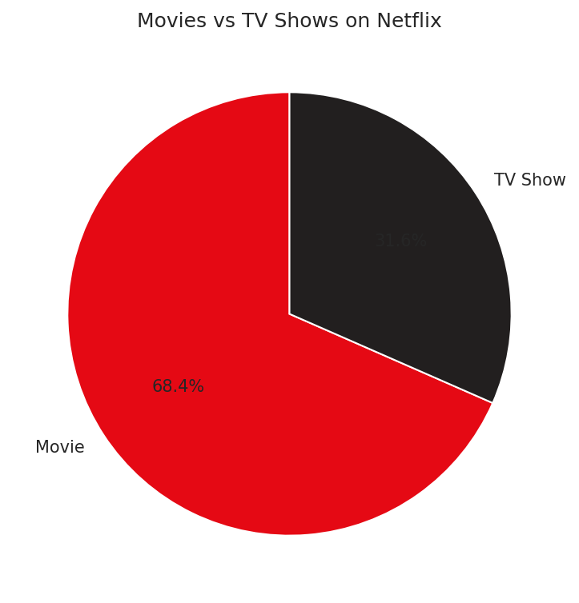
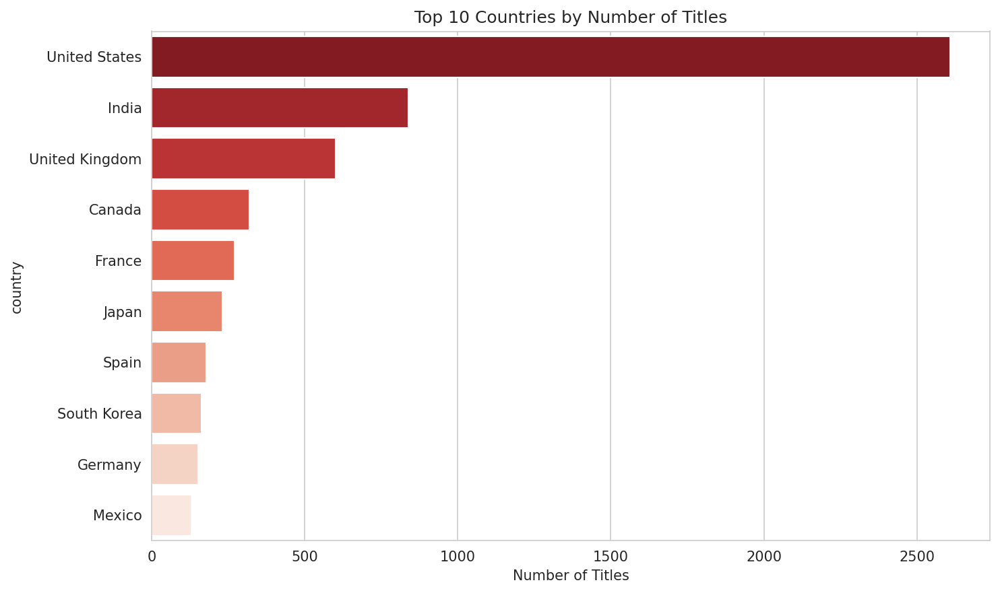
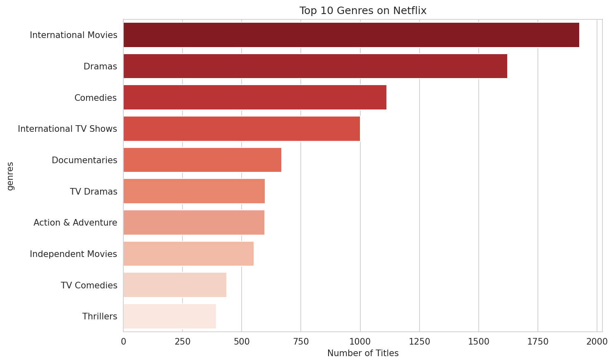
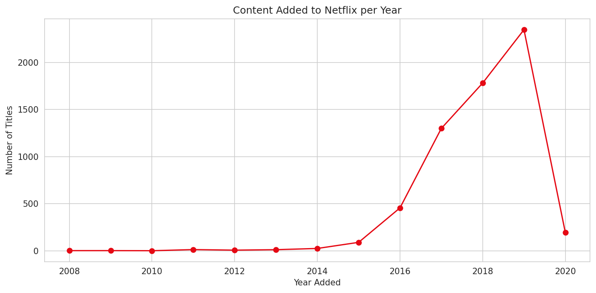

# 🎬 Netflix Data Analysis

An end-to-end Exploratory Data Analysis (EDA) project on the Netflix Movies and TV Shows catalog — covering data cleaning, business-question analysis, visualization, and written data-analyst insights.


## 📌 Overview

This project analyzes ~6,200 titles from Netflix's catalog to answer real business questions a data/content analyst might face: What kind of content dominates the platform? Which countries and genres lead? How has the library grown over time? The goal is not just to plot charts, but to extract and communicate actionable insights.

## 🗂️ Project Structure

```
Netflix-Data-Analysis/
│
├── dataset/
│      netflix_titles.csv
│
├── notebooks/
│      Netflix_EDA.ipynb
│
├── images/              # exported charts
│
├── presentation/        # optional slides/summary for stakeholders
│
├── README.md
├── requirements.txt
└── .gitignore
```

## 📊 Dataset

**Source:** [Netflix Movies and TV Shows](https://www.kaggle.com/datasets/shivamb/netflix-shows) (Kaggle, originally compiled by Shivam Bansal from Flixable data).

| Column | Description |
|---|---|
| `show_id` | Unique ID for each title |
| `type` | Movie or TV Show |
| `title` | Title name |
| `director` | Director(s) |
| `cast` | Main cast |
| `country` | Country/countries of production |
| `date_added` | Date added to Netflix |
| `release_year` | Year the title was originally released |
| `rating` | Content rating (TV-MA, PG, etc.) |
| `duration` | Movie length in minutes, or number of seasons |
| `listed_in` | Genre(s) |
| `description` | Short synopsis |

## 🔧 Setup

```bash
git clone https://github.com/<your-username>/Netflix-Data-Analysis.git
cd Netflix-Data-Analysis
pip install -r requirements.txt
jupyter notebook notebooks/Netflix_EDA.ipynb
```

## 🔍 What's in the Notebook

1. **Load & Inspect** — `read_csv`, `head`, `tail`, `shape`, `info`, `describe`
2. **Data Cleaning** — missing values, duplicates, imputation, date parsing, dtype fixes, renaming
3. **EDA** across 8 business-question areas:
   - Basic stats (Movie vs TV Show split, releases per year)
   - Country analysis (top producing countries)
   - Genre analysis (most/least common genres)
   - Rating analysis (content maturity distribution)
   - Director & actor analysis (most prolific contributors)
   - Time analysis (catalog growth by year/month)
   - Duration analysis (movie runtimes, TV show seasons)
4. **Visualizations** — bar charts, pie charts, line charts, box plots, histograms, a correlation heatmap
5. **Written insights** after each analysis, in plain data-analyst language

## 💡 Key Insights

- **Movies dominate** the catalog (~70%) over TV Shows, showing Netflix's historical bias toward film content.
- **The US and India** are by far the top content-producing countries.
- **International Movies, Dramas, and Comedies** are the most common genres — a mix of broad appeal and regional content.
- **TV-MA and TV-14** are the most frequent ratings, meaning the catalog skews toward mature/teen audiences rather than young children.
- **Library growth exploded between 2016–2019**, aligning with Netflix's global expansion and original-content investment.
- Most **movies run ~90–100 minutes**; most **TV shows last only 1–2 seasons**, suggesting a preference for limited series over long-running shows.

## 📈 Sample Visualizations

| | |
|---|---|
|  |  |
|  |  |

## 🛠️ Tools Used

Python · Pandas · NumPy · Matplotlib · Seaborn · Plotly · Jupyter Notebook · Git & GitHub

## 🎤 Interview Prep

See [`INTERVIEW_PREP.md`](INTERVIEW_PREP.md) for answers to common questions about this project (why this project, challenges faced, how missing values were handled, choice of visualizations, and key business insights).

## 📄 License

This project is licensed under the MIT License. The dataset itself is provided by Kaggle/Flixable and is subject to their terms.
